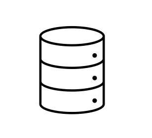
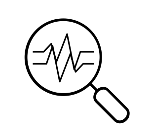

# European Air Quality Portal — Training

<p class="portal-subtitle">Supporting European air quality reporting, assessment and collaboration</p>

```{image} _static/images/AQPortal_banner.png
:alt: European Air Quality Portal
:width: 100%
:class: portal-banner-image
```

<nav class="landing-section-nav" aria-label="Portal sections"><a href="pages/aq-ereporting.html">AQ eReporting</a><a href="pages/data-tables.html">Data tables</a><a href="pages/tools-and-guidance.html">Tools and guidance</a><a href="pages/links.html">Links</a><a href="news/index.html">News</a></nav>

<h2 class="welcome-title">Welcome to the AURA Portal Training!</h2>

**TRAINING COPY — not official documentation.**

The **European Air Quality (AQ) Portal** supports the Air Quality eReporting system, an initiative of the [European Commission](https://commission.europa.eu/select-language?destination=/node/1) managed by the [European Environment Agency](https://www.eea.europa.eu/en) with support from the [European Topic Centre on Human Health and the Environment](https://www.eionet.europa.eu/etcs/etc-he).

It brings together technical documentation, reporting services, interactive viewers, downloadable data, legal references, guidance and meeting resources for EU Member States and other EEA member and cooperating countries.

```{raw} html
<!-- LATEST_NEWS_START -->
<section class="landing-latest-news" aria-labelledby="latest-news-title">
  <div class="latest-news-heading">
    <h2 id="latest-news-title">Latest news</h2>
    <span class="latest-news-date">23 November 2026</span>
  </div>
  <h3>
    <a href="news/2026-11-23-training-news.html">training news</a>
  </h3>
  <p>training version available</p>
  <div class="latest-news-links">
    <a class="latest-news-read" href="news/2026-11-23-training-news.html">Read the full news item →</a>
    <a href="news/index.html">All news</a>
  </div>
</section>
<!-- LATEST_NEWS_END -->

<div class="landing-services-layout">
  <section class="landing-reporting-card" aria-labelledby="reporting-status-title">
    <h2 id="reporting-status-title">Reporting status</h2>

    <div class="reporting-detail">
      <span class="reporting-icon" aria-hidden="true">🗓️</span>
      <div><strong>Deadline</strong><br>30 September 2026</div>
    </div>

    <div class="reporting-detail">
      <span class="reporting-icon" aria-hidden="true">📤</span>
      <div><strong>Submission</strong><br>Data Flows B–G — reporting year 2025 — through Reportnet 2</div>
    </div>

    <div class="reporting-countdown">
      <span id="traffic-light" class="traffic-light" aria-hidden="true">
        <span class="light"></span>
        <span class="light"></span>
        <span class="light"></span>
      </span>
      <div><strong>Time remaining</strong><br><span id="countdown"></span></div>
    </div>
  </section>

  <section class="landing-viewers" aria-label="Training examples"><a class="landing-viewer-card" href="pages/aq-ereporting.html"><span>AQ eReporting</span></a><a class="landing-viewer-card" href="pages/data-tables.html"><span>Data tables</span></a><a class="landing-viewer-card" href="pages/tools-and-guidance.html"><span>Tools and guidance</span></a><a class="landing-viewer-card" href="pages/links.html"><span>Links</span></a></section>
</div>

<aside class="landing-contact" aria-label="Contact the AQ IPR helpdesk">
  <strong>Contact us</strong>
  <span>Questions about Air Quality eReporting? Email the AQ IPR helpdesk at</span>
  <a href="mailto:aqipr.helpdesk@eionet.europa.eu">aqipr.helpdesk@eionet.europa.eu</a>
  <small>If the link does not open your email application, copy the address.</small>
</aside>
```


```{toctree}
:maxdepth: 1
:hidden:
:caption: Portal examples

pages/aq-ereporting
pages/data-tables
```

```{toctree}
:maxdepth: 1
:hidden:
:caption: Resources

pages/tools-and-guidance
pages/links
```

```{toctree}
:maxdepth: 1
:hidden:
:caption: News

news/index
```
